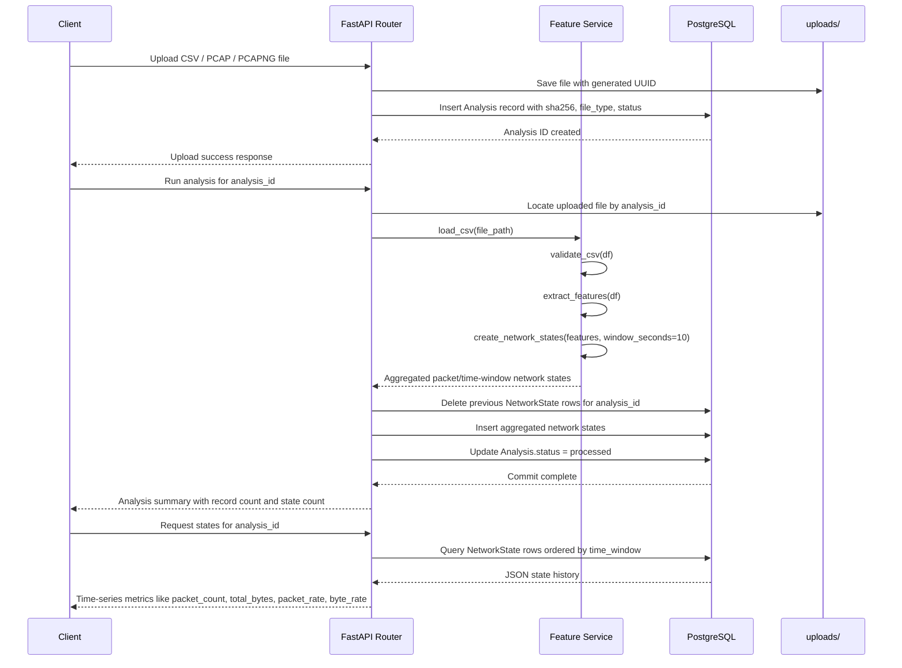

# KavachX

KavachX is a FastAPI-based backend for network traffic analysis and AI-assisted attack forecasting. It accepts uploaded network traffic files, validates their structure, extracts traffic features, aggregates them into time-window states, and stores the resulting analysis metadata and state summaries in PostgreSQL.

## Project Overview

- API server: FastAPI
- Database: PostgreSQL with SQLAlchemy
- Storage: uploaded files in the uploads folder
- Analysis flow: upload -> validate -> feature extraction -> time-window aggregation -> persist network states

## Data Flow Diagram

